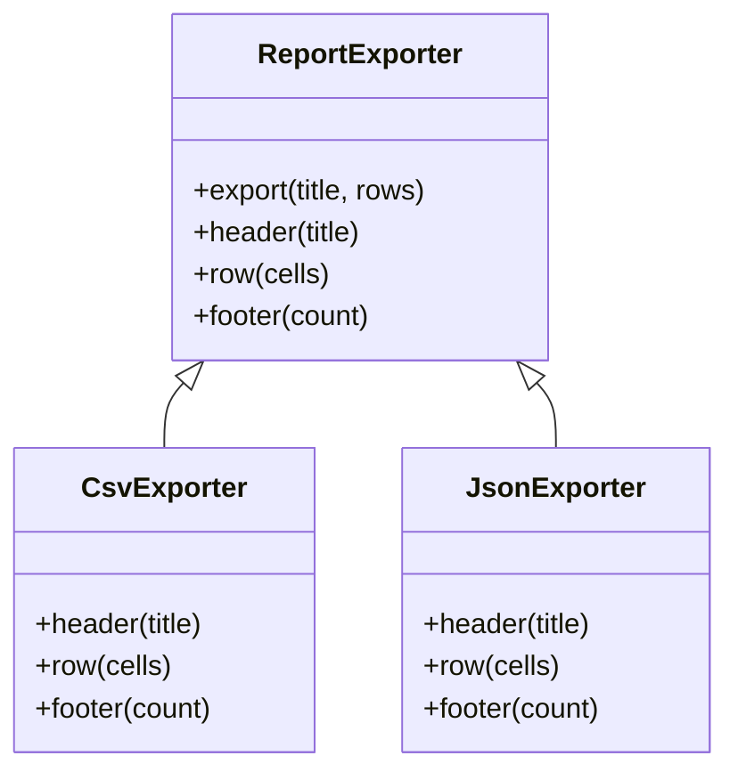

## Overview

Template method defines the skeleton of an algorithm in a base class and lets subclasses fill in some of the steps. The order of the steps is fixed in one place, and the variable steps are abstract methods. It is the inheritance-based way to reuse a flow. An interviewer wants to hear which steps are fixed, which vary, and why the base method is final.

## What to know

1. Intent and the problem it solves :: Several classes run the same sequence of steps, such as open, fetch, format and write, and only a few steps differ. Without the pattern, each class copies the whole sequence and the copies drift apart. Template method keeps the sequence once and makes only the differing steps variable.
2. Structure and participants :: An abstract base class has one template method that calls the steps in order. The steps are abstract or have default hooks. Concrete subclasses implement the varying steps. The template method is final, so a subclass cannot change the order.
3. A worked example in Java :: A report exporter that writes a header, one line per row and a footer. CSV and JSON exporters share the same flow and differ only in how each part is written. The example runs both exporters on the same data.
4. When to use it and when not to :: Use it when the flow is stable and several variants share most of it. Do not use it when the steps differ in order, or when the variation is better expressed by composition. Deep inheritance is the main cost, and a subclass that overrides too many hooks is a sign the pattern is wrong.
5. Related patterns and how it shows up in interviews :: Template method uses inheritance, while Strategy swaps a whole algorithm through composition. Hooks are the optional steps a subclass may override. It shows up in report, import and game turn problems, where every game has the same turn order and only the rules differ.

## Recap

- Template method: a fixed flow in a base class, with variable steps in subclasses.
- Make the template method final so the order cannot change.
- Hooks are optional steps with a default body. Use them sparingly.

## Go deeper

### The problem it solves {point: 0}

Suppose the company needs a CSV export and then a JSON export of the same sales report. Each exporter starts by writing a title, loops over the rows and writes a footer. The first copy works. The second copy changes the loop to skip empty rows, but the first copy does not get that fix. After a few months the two exporters behave differently for the same input, and nobody knows which one is right.

### Structure {point: 1}

ReportExporter holds the template method export(). It calls header(), row() and footer() in a fixed order. Those three steps are abstract, so each subclass must supply them. CsvExporter and JsonExporter implement the steps for their format. Callers only use export() and never call the steps directly.



### Example: Sales report exporter {point: 2}

The example has one report with two rows of data. The base class writes the title, then each row, then the footer. CsvExporter writes a comment line for the title and comma-separated rows. JsonExporter writes one JSON object with an array of rows and keeps a counter so it does not write a trailing comma. Both exporters run the same export() method.

```java
public class Main {

    static abstract class ReportExporter {

        // Template method: the order of the steps is fixed here.
        public final String export(String title, String[][] rows) {
            StringBuilder out = new StringBuilder();
            out.append(header(title));
            for (String[] row : rows) {
                out.append(row(row));
            }
            out.append(footer(rows.length));
            return out.toString();
        }

        protected abstract String header(String title);
        protected abstract String row(String[] cells);
        protected abstract String footer(int count);
    }

    static class CsvExporter extends ReportExporter {
        protected String header(String title) {
            return "# " + title + "\n";
        }

        protected String row(String[] cells) {
            return String.join(",", cells) + "\n";
        }

        protected String footer(int count) {
            return "# rows: " + count + "\n";
        }
    }

    static class JsonExporter extends ReportExporter {
        private int written;

        protected String header(String title) {
            written = 0;
            return "{\"title\":\"" + title + "\",\"rows\":[\n";
        }

        protected String row(String[] cells) {
            String separator = written == 0 ? "" : ",\n";
            written++;
            return separator + "  [\"" + String.join("\",\"", cells) + "\"]";
        }

        protected String footer(int count) {
            return "\n]}\n";
        }
    }

    public static void main(String[] args) {
        String[][] rows = {
            {"North", "1200"},
            {"South", "950"}
        };

        System.out.print(new CsvExporter().export("Sales", rows));
        System.out.println("---");
        System.out.print(new JsonExporter().export("Sales", rows));
    }
}
```

### When to use it and when not to {point: 3}

Use the pattern when the same flow appears in several classes and only a few steps change. It keeps the order in one place, so a fix in the flow applies to all variants. The costs are inheritance and a fixed order. A subclass cannot change the order, and a base class with many hooks is hard to follow. If the variation is a whole algorithm, use Strategy instead. If the steps are unrelated, a plain method per step is enough.

### In interviews {point: 4}

Name Template method for flows that repeat: a game turn where every player draws, plays and ends the turn, a file importer that reads, validates, maps and saves, or a report that always has a header, body and footer. In a game LLD round, the base Game class can own the turn loop and subclasses such as Chess or Tic-tac-toe can provide the rules. Compare it with Strategy: Template method varies steps inside a fixed flow by inheritance, while Strategy replaces the whole algorithm by composition. Mention that a final template method is what keeps the flow safe.

### Modern Java

Java lets you pass the varying steps as lambdas or interfaces, which gives the same shape with composition. A method that takes a Function for the row formatter has the same effect as a row() hook, and it avoids a class per format. Use this form when the steps are small and have no state.

## Interview questions

- What is the difference between Template method and Strategy?
- Why should the template method be final?
- What makes a step a hook rather than an abstract step?
- How would you add a PDF exporter without changing the base class?

## Common mistakes

- Leaving the template method non-final, so a subclass can change the order of the steps.
- Adding a hook for every small difference, which turns the base class into a long list of optional methods.
- Putting state that all variants need into the subclass instead of the base class.
- Calling the steps from outside the template method, which bypasses the fixed order.
