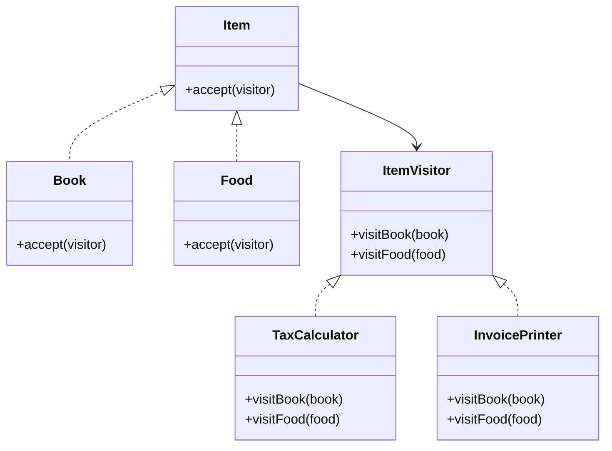

## Overview

Visitor lets you add new operations to a set of classes without changing those classes. Each element accepts a visitor, and the visitor has one method per element type. The call goes to the right method through two dispatches, which is called double dispatch. An interviewer wants to hear when the element types are stable and the operations change often.

## What to know

1. Intent and the problem it solves :: A cart holds books and food, and the team needs a tax calculation, then an invoice printer, then a shelf report. Adding each operation as a method on every item class spreads unrelated code across all items. Visitor keeps each operation in its own class and leaves the item classes alone.
2. Structure and participants :: The element interface declares accept(visitor). Each concrete element calls the visitor method that matches its own type. The visitor interface declares one visit method per element type. Concrete visitors hold one operation each.
3. A worked example in Java :: A shopping cart with books and food. A tax calculator and an invoice printer both visit the same items. The example shows the item classes do not change when the new operation is added.
4. When to use it and when not to :: Use it when the element types are stable and new operations are added often, such as a syntax tree or a document model. Do not use it when new element types are added often, because each new type changes every visitor. Also avoid it when the operations are few and the element types are simple methods.
5. Related patterns and how it shows up in interviews :: Visitor is the opposite trade-off to adding a method per class: adding operations is easy, adding types is hard. It is related to Interpreter, where the expression tree is often walked by a visitor, and to Iterator, which walks the elements without knowing what they do. It shows up in file system, document export and expression tree problems.

## Recap

- Visitor: add operations by adding visitor classes, not by changing element classes.
- Double dispatch picks the visit method from the element type.
- Easy to add operations, hard to add element types.

## Go deeper

### The problem it solves {point: 0}

Suppose a cart has Book and Food items. First the team needs a tax total. Then they need an invoice line for each item. Then they need a shelf report for books only. Each new feature becomes a new method in Book and in Food, so the item classes grow with code that has nothing to do with what a book is. Each new feature also needs a type check or an instanceof test in the caller, which is easy to forget.

### Structure {point: 1}

Item is the element interface and has accept(visitor). Book and Food call visitor.visit(this), passing themselves. ItemVisitor declares visit(Book) and visit(Food). TaxCalculator and InvoicePrinter implement the visitor interface. The call item.accept(visitor) selects the element method first, and then the visitor method for that element type second. That is the double dispatch.



### Example: Shopping cart tax and invoice {point: 2}

The cart holds three items. The tax calculator applies five percent to books and twelve percent to food, and adds up the tax. The invoice printer prints one line per item. The item classes only know how to accept a visitor. Adding a new operation means writing one new class.

```java
public class Main {

    interface ItemVisitor {
        void visit(Book book);
        void visit(Food food);
    }

    interface Item {
        void accept(ItemVisitor visitor);
        String name();
        int priceCents();
    }

    static class Book implements Item {
        private final String title;
        private final int priceCents;

        Book(String title, int priceCents) {
            this.title = title;
            this.priceCents = priceCents;
        }

        public void accept(ItemVisitor visitor) { visitor.visit(this); }
        public String name() { return title; }
        public int priceCents() { return priceCents; }
    }

    static class Food implements Item {
        private final String label;
        private final int priceCents;

        Food(String label, int priceCents) {
            this.label = label;
            this.priceCents = priceCents;
        }

        public void accept(ItemVisitor visitor) { visitor.visit(this); }
        public String name() { return label; }
        public int priceCents() { return priceCents; }
    }

    static class TaxCalculator implements ItemVisitor {
        private int taxCents;

        public void visit(Book book) { taxCents += book.priceCents() * 5 / 100; }
        public void visit(Food food) { taxCents += food.priceCents() * 12 / 100; }

        int total() { return taxCents; }
    }

    static class InvoicePrinter implements ItemVisitor {
        public void visit(Book book) {
            System.out.printf("Book  %-22s %7.2f%n", book.name(), book.priceCents() / 100.0);
        }

        public void visit(Food food) {
            System.out.printf("Food  %-22s %7.2f%n", food.name(), food.priceCents() / 100.0);
        }
    }

    public static void main(String[] args) {
        Item[] cart = {
            new Book("Effective Java", 3200),
            new Food("Coffee beans", 1200),
            new Book("Refactoring", 4500)
        };

        InvoicePrinter printer = new InvoicePrinter();
        for (Item item : cart) {
            item.accept(printer);
        }

        TaxCalculator tax = new TaxCalculator();
        for (Item item : cart) {
            item.accept(tax);
        }
        System.out.printf("Tax total: %.2f%n", tax.total() / 100.0);
    }
}
```

### When to use it and when not to {point: 3}

Use Visitor when the set of element types is fixed and the operations on them keep growing. Typical cases are syntax trees, document models and file system nodes. Each operation stays in one class, which makes it easy to test. The cost is that a new element type needs a new method in every visitor. If element types change often, or the operations are only one or two, put the method on the element or use a switch over a sealed set of types instead.

### In interviews {point: 4}

Name Visitor when the question asks for many operations on a stable model: export a document to HTML and to plain text, compute size and print a tree in a file system, or evaluate and print an expression. In a text editor LLD round, a document made of paragraphs and images can be exported with one visitor per format. Say the trade-off out loud: adding a type touches every visitor, and adding an operation touches none of the types. Compare it with Iterator, which walks a structure, while Visitor does work on each element.

### Modern Java

Java 17 records and sealed interfaces make small element sets easy to write, and a switch over a sealed type can replace a visitor for one operation. Use a visitor when several operations need the same walk over the elements.

## Interview questions

- What does double dispatch mean in this example?
- Why is Visitor a poor fit when new element types arrive often?
- How does Visitor differ from putting each operation on the element class?
- Which pattern would you use to walk the elements, and which to act on them?

## Common mistakes

- Using Visitor for a model that changes its element types every week.
- Adding a type check with instanceof in the caller, which defeats the double dispatch.
- Making the visitor hold state that belongs to the element, such as the price of an item.
- Forgetting to add the new visit method to every existing visitor when a new element type is added.
